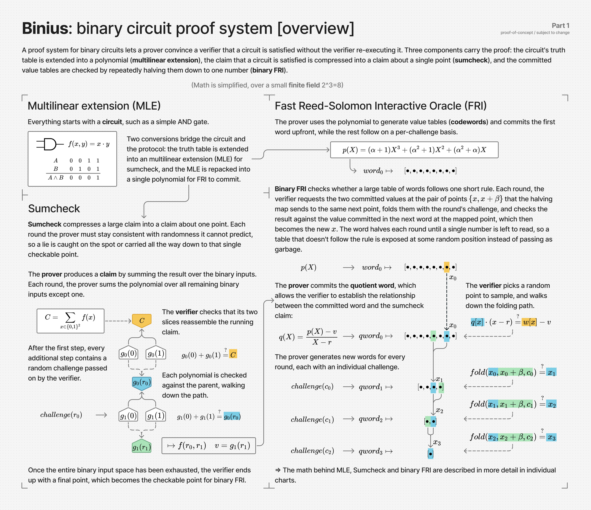
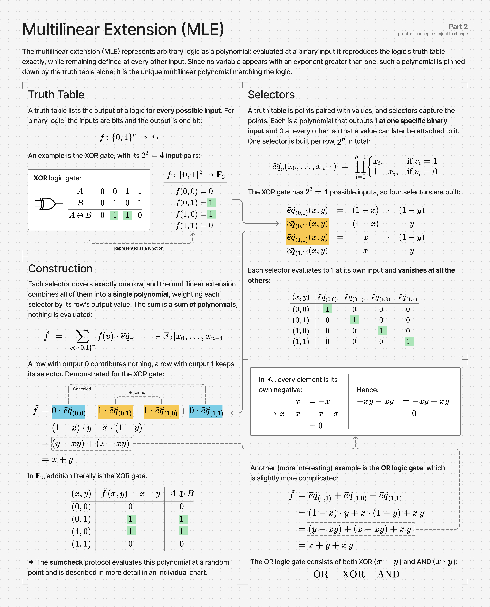
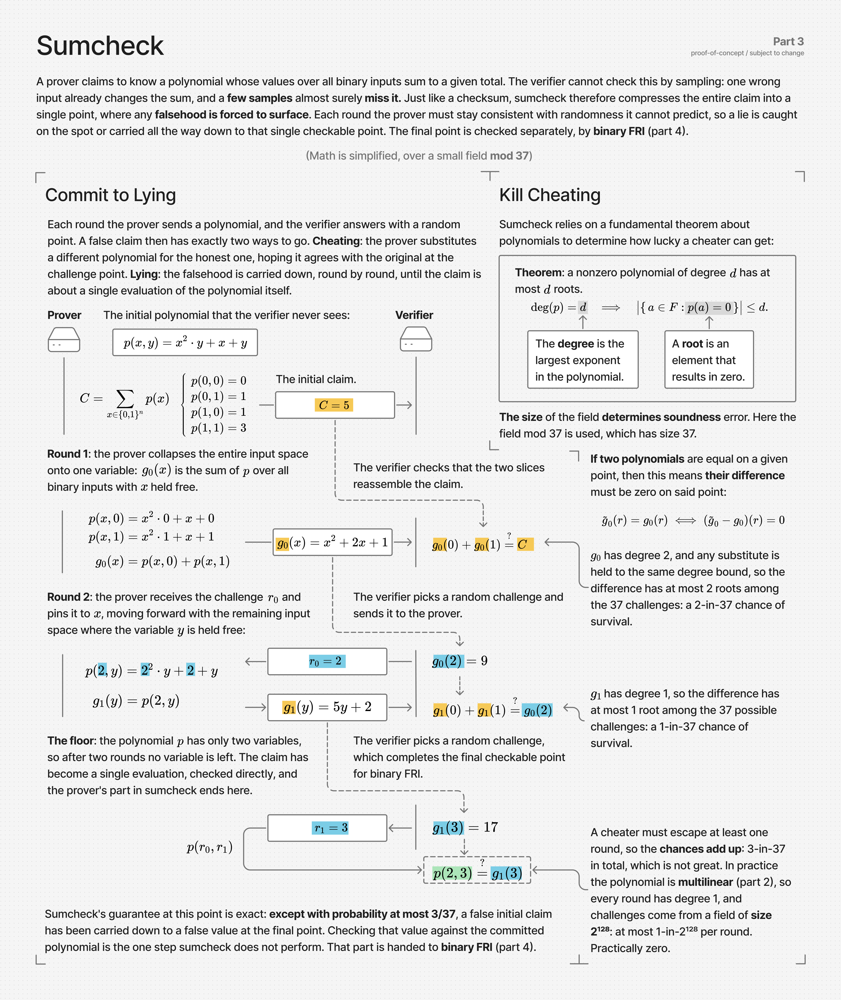

# Binius Research

A personal study of [Binius](https://www.binius.xyz/), a proof system for binary circuits.
Much of the underlying math is studied in [lamafab/algebra](https://github.com/lamafab/algebra).

> **Work in progress.** Charts on binary FRI and binary field towering are still to come.
> Some of the Lean files from `algebra` might move here in the near future.



## Overview

Binius lets a prover convince a verifier that a boolean circuit is satisfied without the
verifier re-executing it. Three components carry the proof:

1. **Multilinear extension (MLE).** The circuit's truth table is extended into a multilinear
   polynomial over the boolean hypercube.
2. **Sumcheck.** A claim about all `2ⁿ` gate evaluations is written as a hypercube sum and
   reduced, round by round, to a single evaluation claim `p̃(r) = v` at a random point `r`.
3. **Binary FRI and polynomial commitment.** The MLE table is Reed-Solomon encoded over
   `GF(2ᵏ)`, Merkle-committed, and proximity-tested by additive folding. The verifier opens
   the committed table at `r` and accepts iff the opened value equals `v`.

Soundness is the union bound of three terms: sumcheck error (`n·2⁻ᵏ` per round, from
Schwartz-Zippel over the extension field), FRI query failure (from the code distance), and
Merkle binding (the random-oracle assumption). In the real system the constants are tuned so
the total stays below `2⁻¹²⁸`.

The pipeline in one line:

```
circuit f : {0,1}ⁿ → 𝔽₂
  → MLE: unique multilinear polynomial matching f on the hypercube
  → sumcheck: hypercube sum reduces to one evaluation claim p̃(r) = v
  → commitment: RS-encode over GF(2ᵏ), Merkle-commit, fold and open at r
  → verifier accepts iff the opened value equals v
```

## Multilinear extension

The circuit's truth table is extended into the unique multilinear polynomial agreeing with it on
the whole hypercube. A boolean circuit `f : {0,1}ⁿ → 𝔽₂` becomes this polynomial, whose degree is
at most one in each variable.



## Sumcheck

The hypercube sum is reduced one variable at a time: each round the prover sends a univariate
polynomial in the variable being eliminated, the verifier answers with a random challenge, and
the claim is rewritten over the remaining space. A false claim survives only if it agrees with
the honest polynomial at the challenge point, so cheating is caught with probability at most
`d/|𝔽|` per round. After `n` rounds the claim is a single evaluation `p̃(r) = v`, which sumcheck
hands off to the commitment scheme. The chart walks through a two-variable example over a small
field mod 37.



## Further reading

- [lamafab/algebra](https://github.com/lamafab/algebra): the algebra repository with the Lean formalization of the MLE, sumcheck, and binary FRI building blocks
